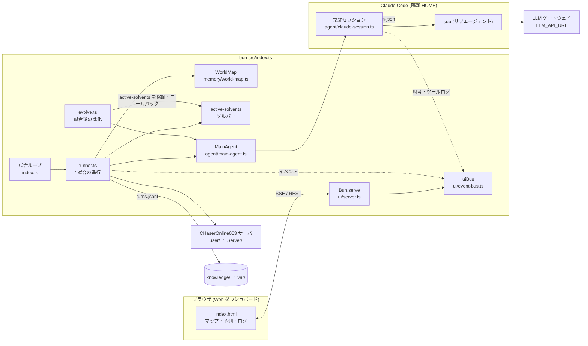

# アーキテクチャ

## 全体像

## 試合のライフサイクル

1. **待機**: `src/index.ts` が Web ダッシュボードを起動し、「開始」が押されるまで待つ。
2. **準備**: 試合ごとに `MainAgent` を作り、`begin()` で Claude Code を常駐させる（入室前のウォームアップ）。
3. **入室**: `Client` が `user/` にログインし、`RoomNumberCheck` で入室する。
4. **試合**: `runner.ts` が `playPhase` を CMD1 → CMD2 の順に回す（後述）。
5. **試合後**: `summary.json` と `diagnosis.md` を書き、`evolve.ts` がメインエージェントに改修させ、リプレイ検証する。
6. **終了**: `MainAgent.end()` でセッションを止める。自動継続なら数秒待って次の試合へ。

## 1フェーズの処理（runner.ts `playPhase`）

1. `active-solver.ts` を毎回動的 import し直す（`?t=` でキャッシュを回避）。読み込みに失敗したら静的 import 版を使い、UI にエラーを出す。
2. ソルバーが手を出す。ただし 1 ターン目の CMD1 は `gr`（初期観測）に固定する。
3. `evaluateBreakpoint` が「新種タイル」「ワープ」「移動不可」「敵が近い」などの理由を集める。止めるためではなく、メインへの情報として使う。
4. `MainAgent.decide()` が手を決める（時間内に JSON が返れば main、そうでなければソルバー手）。
5. サーバへ送信し、返ってきた 3×3 観測を `WorldMap.applyObservation` で反映する。ワープしたら Web マップを再取得する。

フェーズが想定外の状態で終わった場合は、安全手（`pickSafeFallback`）で補完してターンを閉じる。想定外の例外（ゲームオーバー以外）は試合を終了させ、ダッシュボードにエラーを出す。

## ソースファイル構成

| ファイル | 役割 |
| :--- | :--- |
| `src/index.ts` | エントリ。Web サーバ起動、試合ループ、開始／停止の制御 |
| `src/config.ts` | CLI 引数と `.env` から `AgentConfig` を作る |
| `src/paths.ts` | 全パスの定義（唯一の場所） |
| `src/runner.ts` | 1試合の進行、ターン記録 (`TurnRecord`)、`summary.json` の作成 |
| `src/evolve.ts` | 試合後の進化。リプレイ検証に失敗したらロールバック |
| `src/verify.ts` | `bun run verify-solver` の本体（スモークテスト） |
| `src/cli.ts` | Claude Code の Bash から使うツール群 |
| `src/agent/claude-env.ts` | 隔離 env と起動引数（ゲートウェイ・モデル・effort） |
| `src/agent/claude-session.ts` | `--input-format stream-json` の常駐セッション |
| `src/agent/main-agent.ts` | メインエージェント（`begin` / `decide` / `postMatch`）、応答 JSON の解析 |
| `src/agent/models.ts` | ゲートウェイの `/models` 一覧と effort の定義 |
| `src/agent/turn-events.ts` | ブレークポイント理由の評価（停止はしない） |
| `src/solver/active-solver.ts` | 進化対象のソルバー。`decideTurnAction` を export する |
| `src/memory/world-map.ts` | 盤面の座標系、観測の反映、候補評価、SLAM とセグメント統合 |
| `src/memory/knowledge-store.ts` | `knowledge/tiles.json` と `var/room-profiles.json` の読み書き |
| `src/perception/web-map-scraper.ts` | `MapView.jsp` / `listWorldvsresult` の取得とパース（HTTP のみ） |
| `src/client/` | サーバ通信（Cookie 付き HTTP、ポーリングの状態機械、ReturnCode パーサ、公式成績の取得） |
| `src/evolution/analyzer.ts` | 試合後の診断レポート（推定と公式の差、穴の再踏破など） |
| `src/evolution/replay-verifier.ts` | `turns.jsonl` を新ソルバーで再生して検証 |
| `src/tools/` | ロガー（pino）、`run-script` の実行器、公式サイト検索 (`reference`) |
| `src/ui/` | `server.ts`（HTTP/SSE）、`event-bus.ts`（状態配信）、`env-store.ts`（.env 読み書き）、`public/index.html` |
| `src/memory/world-map.test.ts`, `src/client/client.test.ts` | `bun test` の対象 |

## 盤面の表現

- `WorldMap` は自機を原点とする相対座標で盤面を持つ。Web マップ（`MapView.jsp` など）が取れたルームでは、そのグリッドに対して自機の絶対座標を特定（ロック）する。
- Web マップがないルームでは、3×3 観測を重ねる SLAM で相対座標の地図を作る。ワープで観測が矛盾したら新しいセグメントを作り、既知パターンと一意に一致した時点で統合する。
- `toSnapshot()` の内容は毎ターン `var/current/snapshot.json` に書き出される。メインエージェントとツールはこれを読む。

## データの置き場所

| 種類 | 場所 | 管理 |
| :--- | :--- | :--- |
| タイル得点・ルール知識 | `knowledge/tiles.json`, `knowledge/strategy.md` | git |
| 試合ごとのログ | `var/runs/<runId>/` (`turns.jsonl`, `summary.json`, `diagnosis.md`, `final-map.txt`, `solver-snapshot.ts`, `evolution-report.md`) | 除外 |
| ルームごとの成績 | `var/room-profiles.json`（最高得点、Web マップの有無、最高得点時のソルバー） | 除外 |
| 最高得点のソルバー | `var/best-solvers/room<N>.ts` | 除外 |
| 隔離された Claude の HOME | `var/claude-home/` | 除外 |
| 直近の盤面 | `var/current/snapshot.json` | 除外 |
