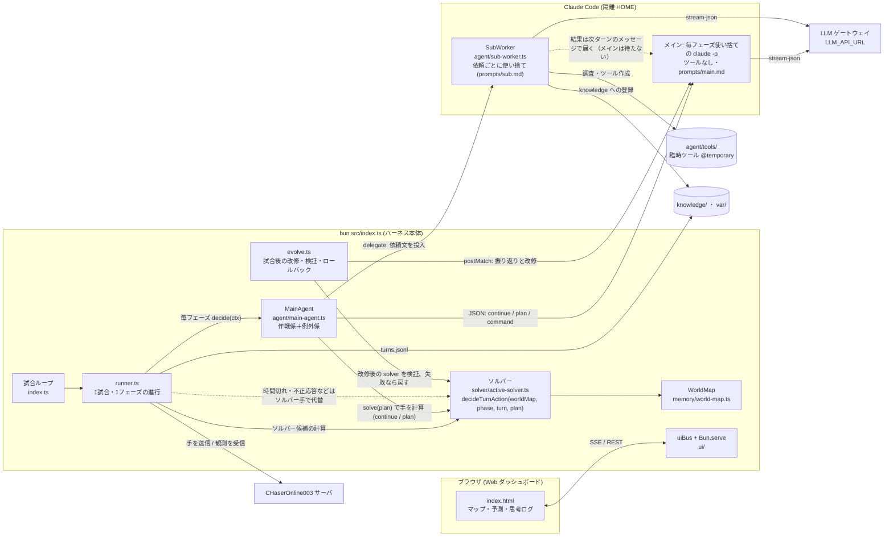

# アーキテクチャ

## 全体像

メインは毎フェーズ「作戦（continue / plan）」か「手（command）」を返す。手の計算はソルバーが行い、メインは作戦の目標を変えるか、ソルバーが想定していない局面だけに介入する。時間のかかる仕事はサブに渡し、結果は後のターンで受け取る。

### 役割分担

| 担当 | 何をするか | 何をしないか |
| :--- | :--- | :--- |
| ソルバー (`active-solver.ts`) | 1手先の計算。毎ターン必ず手を出せる。`plan` の目標へ `firstStepTowards` で追従 | 作戦の立案、試合中の改修 |
| メイン (`main.md`) | 数ターン先の作戦（`plan`）、例外（罠・未知タイル・相手プレイヤー・推定のずれ）への対応（`command`）、サブへの依頼、試合後の改修 | 毎手の細かい計算、待ち時間のかかる調査 |
| サブ (`sub.md`) | ログ分析、タイル得点の推定と登録、公式サイト調査、臨時ツールの作成（`agent/tools/`） | 試合の判断、`active-solver.ts` の編集、CHaserOnline へのログイン |

## 試合のライフサイクル

1. **待機**: `src/index.ts` が Web ダッシュボードを起動し、「準備」が押されるまで待つ。
2. **準備（ルームに入らない）**: `runPrepPhase` が公式のバージョンを確認し、メインがルール・このルームの過去の試合・作戦方針を読んで試合開始時のメモを作る（status=preparing → standby）。スタンバイOK になると「開始」が押せる。
2b. **開始**: 試合ごとに `MainAgent` を作り、`begin(info, 準備の結果)` でシステムプロンプト（main.md＋ルール(official-rules.md)＋コマンド(commands.md)＋作戦方針＋strategy.md）を組み立て、準備のメモから始め、最初の問い合わせ用プロセスを先に起動する。サブは保護ファイルのスナップショットを取る。
3. **入室**: `Client` が `user/` にログインし、`RoomNumberCheck` で入室する。
4. **試合**: `runner.ts` が `playPhase` を CMD1 → CMD2 の順に回す（後述）。
5. **試合後**: `summary.json` と `diagnosis.md` を書き、`evolve.ts` がメインに `postMatch` で改修させ、リプレイ検証する。
6. **終了**: `MainAgent.end()` で先行起動したプロセスとサブを止める。自動継続なら数秒待って次の試合へ。

`bun run play` は同じ流れを WebUI なしで 1 試合だけ行う（`src/play.ts`）。

## 1フェーズの処理（runner.ts `playPhase`）

1. `active-solver.ts` を毎回動的 import し直す（`?t=` でキャッシュを回避）。読み込みに失敗したら静的 import 版を使い、UI にエラーを出す。
2. ソルバーの候補を出す（現在の作戦 `plan` を渡す）。ただし 1 ターン目の CMD1 は `gr`（初期観測）に固定する。
3. `evaluateBreakpoint` が「新種タイル」「ワープ」「移動不可」「敵が近い」などの理由を集める。止めるためではなく、メインへの情報として渡す。
4. `MainAgent.decide()` がメッセージ（盤面 ASCII・現在の作戦・ソルバー候補・目標候補・合法手・サブ結果）を受けて返答する。
   - `continue`: ソルバーが `plan` 付きで手を打つ。
   - `plan`: `target` を新しい作戦にして、ソルバーが手を打つ。
   - `command`: 指定された手をそのまま使う。
   - 時間切れ・不正応答などは、ソルバー手を採用する（`source: "solver"`）。
5. サーバへ送信し、返ってきた 3×3 観測を `WorldMap.applyObservation` で反映する。ワープしたら Web マップを再取得する。

フェーズが想定外の状態で終わった場合は、安全手（`pickSafeFallback`）で補完してターンを閉じる。想定外の例外（ゲームオーバー以外）は試合を終了させ、ダッシュボードにエラーを出す。

## ソースファイル構成

| ファイル | 役割 |
| :--- | :--- |
| `src/index.ts` | エントリ。Web サーバ起動、試合ループ、開始／停止の制御 |
| `src/play.ts` | `bun run play`。WebUI なしで 1 試合（`--evolve` で試合後の改修まで） |
| `src/config.ts` | CLI 引数と `.env` から `AgentConfig` を作る（メイン／サブのモデル・effort・予算） |
| `src/paths.ts` | 全パスの定義（唯一の場所） |
| `src/runner.ts` | 1試合の進行、ターン記録 (`TurnRecord`)、`summary.json` の作成 |
| `src/evolve.ts` | 試合後の進化。リプレイ検証に失敗したらロールバック |
| `src/verify.ts` | `bun run verify-solver` の本体（スモークテスト） |
| `src/cli.ts` | Claude Code の Bash から使うツール群 |
| `src/agent/claude-env.ts` | 隔離 env と起動引数（ゲートウェイ・モデル・effort） |
| `src/agent/claude-session.ts` | `--input-format stream-json` で起動する Claude Code プロセス（使い捨て・常駐の両用。`ask` は同時に 1 件） |
| `src/agent/main-agent.ts` | メインエージェント（`begin` / `decide` / `postMatch`）、応答 JSON の解析、作戦の追跡 |
| `src/agent/sub-worker.ts` | サブエージェント（`SubWorker`）。依頼を順に裏で処理し、結果を保持する |
| `src/agent/models.ts` | ゲートウェイの `/models` 一覧と effort の定義 |
| `src/agent/turn-events.ts` | ブレークポイント理由の評価（停止はしない） |
| `src/solver/active-solver.ts` | 進化対象のソルバー。`decideTurnAction` を export する |
| `src/memory/world-map.ts` | 盤面の座標系、観測の反映、候補評価、`firstStepTowards`、SLAM とセグメント統合 |
| `src/memory/knowledge-store.ts` | `knowledge/tiles.json` と `var/room-profiles.json` の読み書き |
| `src/perception/web-map-scraper.ts` | `MapView.jsp` / `listWorldvsresult` の取得とパース（HTTP のみ） |
| `src/client/` | サーバ通信（Cookie 付き HTTP、ポーリングの状態機械、ReturnCode パーサ、公式成績の取得） |
| `src/evolution/analyzer.ts` | 試合後の診断レポート（推定と公式の差、穴の再踏破など） |
| `src/evolution/replay-verifier.ts` | `turns.jsonl` を新ソルバーで再生して検証 |
| `src/tools/` | ロガー（pino）、公式サイト検索 (`reference`) |
| `src/ui/` | `server.ts`（HTTP/SSE）、`event-bus.ts`（状態配信）、`env-store.ts`（.env 読み書き）、`public/index.html` |
| `agent/prompts/main.md`, `agent/prompts/sub.md` | メインとサブの役割・返答形式 |
| `agent/tools/` | エージェントが作る臨時／補助ツール（規約は `agent/tools/README.md`） |
| `src/memory/world-map.test.ts`, `src/client/client.test.ts` | `bun test` の対象 |

## 盤面の表現

- `WorldMap` は自機を原点とする相対座標で盤面を持つ。Web マップ（`MapView.jsp` など）が取れたルームでは、そのグリッドに対して自機の絶対座標を特定（ロック）する。
- Web マップがないルームでは、3×3 観測を重ねる SLAM で相対座標の地図を作る。ワープで観測が矛盾したら新しいセグメントを作り、既知パターンと一意に一致した時点で統合する。
- `toSnapshot()` の内容は毎ターン `var/current/snapshot.json` に書き出される。メインとサブ、ツールはこれを読む。
- `firstStepTowards(x, y)` は目標までの最初の一歩を返す。到達済みなら `"here"`、到達不能なら `null`。作戦 (`plan`) の追従と解除に使う。

## データの置き場所

| 種類 | 場所 | 管理 |
| :--- | :--- | :--- |
| タイル得点・ルール知識 | `knowledge/tiles.json`, `knowledge/strategy.md`, `knowledge/server.json`（サーバ仕様の実測） | git |
| 臨時・補助ツール | `agent/tools/*.ts` | git |
| 試合ごとのログ | `var/runs/<runId>/` (`turns.jsonl`, `summary.json`, `diagnosis.md`, `final-map.txt`, `solver-snapshot.ts`, `evolution-report.md`) | 除外 |
| ルームごとの成績 | `var/room-profiles.json`（最高得点、Web マップの有無、最高得点時のソルバー） | 除外 |
| 最高得点のソルバー | `var/best-solvers/room<N>.ts` | 除外 |
| 隔離された Claude の HOME | `var/claude-home/` | 除外 |
| 直近の盤面 | `var/current/snapshot.json` | 除外 |
