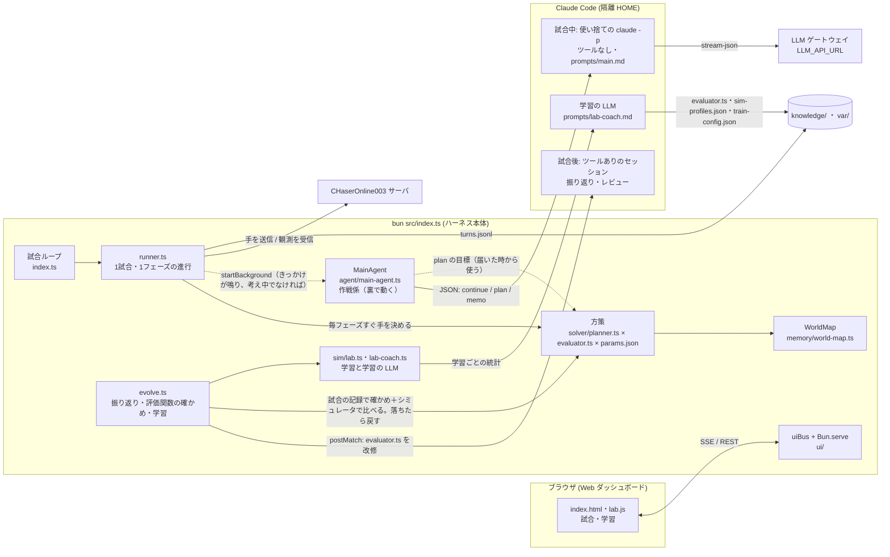

# アーキテクチャ

## 全体像

手は毎フェーズ経路探索の方策（`src/solver/planner.ts`＋評価関数 `evaluator.ts`＋学習したパラメータ `var/policy/params.json`）がすぐ出す。試合中の LLM は手を待たせず裏で盤面を読み、作戦（`plan` の目標）だけを出す。試合後は LLM が振り返って評価関数を直し（確かめに落ちたら戻す）、シミュレータで方策を学習し、学習の LLM が学習環境を直す。方策・シミュレータ・学習の図と詳細は [learning.md](learning.md)。

2026-11-22 に、サブエージェント・LLM の返答を待って打つモード（`AGENT_ASYNC=false`）・古いソルバー（`active-solver.ts`、`PLAY_POLICY`）は外した。

### 役割分担

| 担当 | 何をするか | 何をしないか |
| :--- | :--- | :--- |
| 方策 (`planner.ts`＋`evaluator.ts`) | 毎フェーズ必ず手を出す（数ミリ秒）。`plan` の目標も目標の候補に入れる | 作戦の立案、試合中の改修 |
| 試合中の LLM (`main.md`) | 盤面・経過・メモを読み、数ターン先の作戦（`plan`）を出す。メモを次の問い合わせへ引き継ぐ | 手を打つ（手はいつも方策）、ツールを使う |
| 試合後の LLM（振り返り） | 診断を読み、評価関数 `evaluator.ts`・`knowledge/`・`agent/tools/` を直す。ハーネスへのレビュー | それ以外の `src/` の編集（edit-guard が戻す） |
| 学習の LLM (`lab-coach.md`) | 学習の統計を読み、評価関数・地図の作り方・学習のやり方を直す | 試合中に動く（試合が始まると止まる） |

## 試合のライフサイクル

1. **待機**: `src/index.ts` が Web ダッシュボードを起動し、「準備」が押されるまで待つ。
2. **準備（ルームに入らない）**: `runPrepPhase` が公式のバージョンを確認し、LLM がルール・このルームの過去の試合・作戦方針を読んで試合開始時のメモを作る（status=preparing → standby）。スタンバイOK になると「開始」が押せる。
2b. **開始**: 試合ごとに `MainAgent` を作り、`begin(info, 準備の結果)` でシステムプロンプト（main.md＋ルール(official-rules.md)＋コマンド(commands.md)＋作戦方針＋strategy.md）を組み立て、準備のメモから始め、最初の問い合わせ用プロセスを先に起動する。
3. **入室**: `Client` が `user/` にログインし、`RoomNumberCheck` で入室する。同一ユーザーの二重ログインは断られる（前の試合を停止・ターン上限で終えると約5分）ので、`CHASER_LOGIN_WAIT_MIN` の間 `CHASER_LOGIN_RETRY_SEC` ごとにやり直す（`src/client/login.ts`、停止ボタンで中断）。準備は入室できてから使い切る（入室できなければ残る）。
4. **試合**: `runner.ts` が `playPhase` を CMD1 → CMD2 の順に回す（後述）。
4b. **試合中の障害**: 方策・LLM の処理が例外を投げても、そのフェーズは安全な手（`pickSafeFallback`）で続ける。通信の一時的な失敗は、まだ送っていないフェーズを安全な手で1回送り直す。それでも失敗したら試合を終え、画面に「試合がエラーで終わった」を出す。
5. **試合後**: `summary.json` と `diagnosis.md` を書き、その試合の評価関数とパラメータを `evaluator-snapshot.ts`・`policy-params.json` に控える。`evolve.ts` が LLM に `postMatch` で振り返らせ（シミュレータでの成績を添える）、評価関数が変わっていたら、その試合の記録の盤面で方策を動かして確かめ（`verifyPolicyWithReplay`）、改修前と同じ地図で比べる（`gateEvaluatorChange`）。どちらかに落ちたら元に戻す。範囲外の編集は edit-guard が戻す。続けて方策を学習する（`TRAIN_AFTER_MATCH_MIN` 分。振り返りをしない時も）。学習が終わると学習の LLM が動く（`LAB_COACH`）。
   - これらの試合後の仕事は既定で裏で行う（`POST_MATCH_BACKGROUND=true`、`src/evolution/post-match-queue.ts`）。仕事は1つずつ順に行い、その間に次の試合の準備・入室を始める。進み具合は画面のヘッダの「裏で: …」（状態の `background`）。評価関数を書き換えている間（振り返り・学習の LLM）に始まった試合は、書き換えを始めた時の評価関数の写し `var/current/evaluator-verified.ts` を使う（確かめていない改修を試合に使わない）。直したものは次の次の試合から効く。裏に渡した試合の LLM は画面のメモ・使用量を書かない。`false` なら前の動き（終わるまで次の試合を待つ）
6. **終了**: `MainAgent.end()` で先行起動したプロセスを止める。自動継続なら数秒待って次の試合へ。

`bun run play` は同じ流れを WebUI なしで 1 試合だけ行う（`src/play.ts`。`--no-llm` で LLM なし、`--evolve` で試合後の振り返りと学習まで）。

## 1フェーズの処理（runner.ts `playPhase`）

1. 方策がすぐ手を決める（`decideSolver`。今の作戦 `plan` を渡す）。ただし 1 ターン目の CMD1 は `gr`（初期観測）に固定する。方策が例外を投げたら安全な手。
2. `evaluateBreakpoint` が「新種タイル」「ワープ」「移動不可」「敵が近い」などの理由を集める（止めるためではなく、LLM への情報として渡す）。続けて、試合中の LLM を呼ぶ**きっかけ**を計算する（下の節）。
3. きっかけが鳴っていて（`AGENT_CALL_MODE=every` なら毎回）LLM が考え中でなければ、今の盤面（全体マップ・経過・メモ・方策の今の手・呼んだきっかけ・モデル）で `startBackground` を呼んで裏の問い合わせを始める。考え中に鳴ったきっかけは次に持ち越す（考え中は捨てない。同じきっかけは新しい方だけ。LLM が空いていて 5 ターンより古いものは捨て、summary の `droppedTriggers` に残す）。返答でモデルが選ばれていれば、届いた時から方策をそのモデルに切り替える。前の問い合わせの返答が届いていれば `plan`・メモを反映する（考えている間にワープなどで座標系が変わっていれば、Webマップの絶対座標を通して今の座標に直す。位置合わせできていなければ捨てる。どちらも `llmReplies` の `shift`）。
   - **作戦スクリプト**（`src/solver/tactics.ts`。振り返り・学習の LLM が書く）を毎フェーズ、きっかけを数えた後に呼ぶ（`src/solver/tactics-runtime.ts` の `TacticsRuntime`）。状態（位置・敵の目撃と歩数・得点・当てられた履歴・行ったり来たり・残りターン・今のモデル・鳴ったきっかけ `signals`・準備の切り替えの決まり `rules`・LLM が考え中か・1試合の間残る `memory`）を渡し、返した行動をすぐ反映する: `model`（切り替え。`modelSwitches` の `by` は `tactics`）・`target`（目標。LLM の作戦目標があればそちらが先。着いた時・ワープで消える）・`avoid`（通らないマス）・`askLlm`（LLM を呼ぶ理由。**LLM を呼ぶかはスクリプトが決める**。止まり続けた時の安全網 `noGain` だけはハーネスが呼ぶ）。例外・おかしな値はそのフェーズだけ使わずに数える。記録は `turns.jsonl` の `tactics`・`summary.json` の `tactics`（回数）・行動ログ。既定のスクリプトは作戦方針（敵が 5 マス以内ならハンター、離れて 5 ターンで元のモデル。準備の `modelRules` があればそれ）と「きっかけが鳴ったら LLM を呼ぶ」。
   - 作戦スクリプトの改修は、別プロセスの短い試合（`tactics-check`: 例外・1フェーズ 50ms まで。止まらなければ時間で切る）と、シミュレータで改修前と同じ地図・同じ相手でモデルを切り替えながら比べる（`gateTacticsChange`）。落ちたら戻す。書き換え中に始まった試合は書き換える前の写し（`var/current/tactics-verified.ts`）を使う。
   - 推定得点には Webマップの公式のプット得点・プットダメージ（P:・PD:）を入れる（`setPutScores`。Webマップは1ターンほど遅れる）。変わったターンは `turns.jsonl` の `putChange`、`summary.json` の `hits`（増分・その前の自分の推定得点・直近の敵・モデル）、行動ログの「当てた／当てられた」、diagnosis.md の `PUT_DAMAGE_TAKEN`。`AGENT_TURN_BUDGET_SEC` を超えた問い合わせは止める。
4. サーバへ送信し、返ってきた 3×3 観測を `WorldMap.applyObservation` で反映する。ワープしたら Web マップを再取得する。

### 試合中の LLM を呼ぶきっかけ（`src/agent/triggers.ts`）

試合中の LLM は毎フェーズは呼ばず、「学習した方策が知らないこと」が起きた時（きっかけが鳴った時）だけ呼ぶ（`AGENT_CALL_MODE=trigger`。既定）。LLM は作戦目標と**使うモデル**（特性ごとのモデル）を選ぶ。どのきっかけを使うか・しきい値・きっかけごとの判断の目安は、準備の LLM が決める（下の「試合の設定」）。計算で例外が出ても試合には響かせない。

| きっかけ | もと | 鳴る条件（既定のしきい値） |
| :--- | :--- | :--- |
| モデルの不一致 `modelSplit` | モデル | ほかの特性のモデルに同じ盤面で手を出させ（LLM の目標なし）、試合で使うモデルと違う手を出したモデルが 2 個以上（比べるモデルが少なければその数）。パラメータが同じ（まだ学習していない）モデルは比べない |
| 見込みの急落 `valueDrop` | モデル | （推定得点 ＋ 予定の経路の見込み）が前のフェーズより、経路の見込みの 50% 以上下がった |
| 行く先が無い `noTarget` | モデル | 方策が「行ける目標が無い」を 4 フェーズ続けた |
| 行ったり来たり `stuck` | 観測 | 直近 8 ターンにいたマスが 3 種類以下（相手に置いて当てる手 p…2w… を打ったターンがあれば数えない。攻めの往復なので） |
| 知らないタイル `unknownTile` | 観測 | tiles.json に無い番号を見た（方策は壁として扱う） |
| 敵が近い `enemyNear` | 観測 | 前のターンまでに見えた敵が 3 マス以内 |
| 当てられた `hit` | 観測 | Webマップのプットダメージ（PD）が減った |
| 得点のずれ `scoreGap` | 観測 | Webマップの公式の合計（T）と推定の差が、前に鳴った時から 2000 以上動いた |
| ワープ後の位置合わせ失敗 `warpMiss` | 観測 | ワープの後、位置を合わせられないまま次の手を選んだ |
| 終盤 `endgame` | ターン | 残りが全体の 10% を切った（1回） |
| 定期 `heartbeat` | ターン | 50 ターンごと |
| 得点が増えない `noGain` | 観測 | 推定のアイテム得点が 30 ターン増えない（続く間は 30 ターンごと）。準備で切っても鳴る安全網（同じワープの出入りでは区画が毎回変わり、行ったり来たりが鳴らない） |

- 試合後の評価（`trigger-review.ts`）は、鳴ったきっかけの効き目のほかに、LLM が呼ばれないまま推定得点がターンの 300 点しか増えなかった区間（30 ターン以上、`silentStretches`）を出す。多かった手・方策の理由・その間に鳴ったきっかけを添え、次の準備が切ったきっかけ・しきい値を見直す材料にする。
- 同じきっかけは 5 ターンの間は続けて鳴らない（知らないタイル・当てられた・終盤・定期は別）。しきい値の既定と範囲は `TRIGGER_DEFS`。
- 比べるモデル（モデルの不一致）は、今使っているモデル以外でパラメータが違うもの。モデルを切り替えると入れ替わる。
- 記録: `turns.jsonl` の `triggers`（鳴ったきっかけ: id・名前・フェーズ・値・内容）・`modelVotes`（モデルの手が割れたフェーズだけ、モデルごとの手）・`calledBy`（そのターンに LLM を呼んだきっかけ）・`model`（切り替えた後のモデル）。`summary.json` の `triggers`（鳴った回数 `counts`・条件を満たした回数 `raw`・比べたモデルの数・しきい値）・`callMode`・`matchPlan`（準備で決めた設定）・`modelSwitches`（聞いたターン・前→後・きっかけ）・`finalModel`。`policyModel` は最初のモデル（試合後の学習はこのモデル）。Webマップの得点 `webScore` には、アイテム得点に加えて公式の合計・プット得点・プットダメージも残す。
- 画面: 試合の「いまの判断」に今のモデル・LLM を呼ぶ時・鳴ったきっかけ、準備の欄に準備で決めた設定、「統計」の試合ごとの回数（内訳はマウスで）・モデルの切り替えと全体の 100 ターンあたり、ターン履歴のイベント。
- シミュレータで鳴る回数を数える: `bun src/cli.ts triggers --n 12 [--room N] [--model id]`（Webマップの得点が無いので、当てられた・得点のずれは鳴らない）。

#### 試合の設定（準備の LLM が決める。`src/agent/match-plan.ts`）

準備の返答の最後の JSON に、メモと一緒に `model`（最初のモデル）・`triggers`（`enabled`・`thresholds`・`cooldownTurns`）・`guide`（きっかけごとの判断の目安、160 字まで）を書かせる。準備には選べるモデル（学習済みか・シミュレータでの特性）ときっかけ（既定・範囲）の一覧を見せる。読む時に、範囲の外は範囲に収め、知らないモデル・きっかけは捨てる（直したことは `notes` に残し、試合の初めに画面へ出す）。書かれていなければ既定（モデルは `POLICY_MODEL`、きっかけは全部・既定のしきい値）。試合中の LLM には、呼んだきっかけの横に目安を見せる。

#### 試合後の評価（`src/agent/trigger-review.ts`）

試合の終わりに、きっかけごとに 鳴った回数・LLM を呼んだ回数・返答（目標を出した・そのまま・モデルの切り替え先・返答なし）と、その後 10 ターンの推定得点/ターンを数える。比べるのは「呼んだ後」と「鳴ったが呼ばなかった後」（考え中で持ち越し、5 ターンで捨てたもの）と試合全体。その間に当てられた（Webマップの PD が下がった）回数も数える。モデルごとに、使ったターン数と推定得点/ターンも数える。

- 記録: `var/runs/<runId>/trigger-review.json`、`diagnosis.md` の最後の節（試合後の振り返りもこれを読む）。返答は `turns.jsonl` の `llmReplies`（聞いたターン・きっかけ・返答・モデル・目標）。試合の後に届いた返答は、最後のターンに入れる（評価には入るが `turns.jsonl` には無い）。
- 次の準備: このルームの過去 10 試合の評価をきっかけごとにまとめて、準備のメッセージに入れる（`roomTriggerHistoryText`）。準備の LLM はこれを見て、使うきっかけ・しきい値・目安・最初のモデルを選ぶ。評価のファイルが無い古い試合は、きっかけの記録があれば `turns.jsonl` から作る。
- 画面: 「統計」の「ルームと試合」の「きっかけの評価」（全体、ルームを選ぶとそのルーム）。
- 得点は推定なので、当てられた得点は入らない（当てられた回数で見る）。回数が少ないうちは偶然の差が大きい。

フェーズが想定外の状態で終わった場合は、安全手（`pickSafeFallback`）で補完してターンを閉じる。想定外の例外（ゲームオーバー以外）は試合を終了させ、ダッシュボードにエラーを出す。

## ソースファイル構成

| ファイル | 役割 |
| :--- | :--- |
| `src/index.ts` | エントリ。Web サーバ起動、試合ループ、開始／停止の制御 |
| `src/play.ts` | `bun run play`。WebUI なしで 1 試合（`--evolve` で試合後の振り返りと学習まで） |
| `src/config.ts` | CLI 引数と `.env` から `AgentConfig` を作る（モデル・effort・返答の上限） |
| `src/settings.ts` | `.env` の項目の名前・既定値・説明・分類（`advanced` は「詳しい設定」、`OBSOLETE_SETTINGS` は使われなくなった項目） |
| `src/paths.ts` | 全パスの定義（唯一の場所） |
| `src/runner.ts` | 1試合の進行、ターン記録 (`TurnRecord`)、`summary.json` の作成 |
| `src/evolve.ts` | 試合後の振り返り。評価関数の改修を確かめ、落ちたら戻す。続けて学習 |
| `src/verify.ts` | `bun run verify-policy` の本体（方策のスモークテスト） |
| `src/cli.ts` | Claude Code の Bash から使うツール群 |
| `src/agent/claude-env.ts` | 隔離 env と起動引数（ゲートウェイ・モデル・effort） |
| `src/agent/claude-session.ts` | `--input-format stream-json` で起動する Claude Code プロセス（使い捨て・常駐の両用。`ask` は同時に 1 件） |
| `src/agent/main-agent.ts` | 試合中の LLM（`begin` / `startBackground` / `postMatch`）、応答 JSON の解析、作戦の追跡 |
| `src/agent/triggers.ts` | 試合中の LLM を呼ぶきっかけ（`TRIGGER_DEFS`・`TriggerMonitor`）、特性ごとのモデルの読み込みと比べるモデル |
| `src/agent/trigger-review.ts` | 試合後のきっかけの評価（`trigger-review.json`）と、準備に見せるルームのまとめ |
| `src/agent/match-plan.ts` | 準備の LLM が決める試合の設定（最初のモデル・きっかけ・目安）の読み取りと、準備に見せる選択肢 |
| `src/agent/models.ts` | ゲートウェイの `/models` 一覧と effort の定義 |
| `src/agent/turn-events.ts` | ブレークポイント理由の評価（停止はしない） |
| `src/solver/planner.ts`・`policy.ts`・`types.ts` | 経路探索の方策（試合中の手）。`policy.ts` はパラメータ（`var/policy/params.json`）の読み書きと方策の組み立て。`types.ts` は作戦（`AgentPlan`）と手の判断（`SolverDecision`）の型 |
| `src/solver/evaluator.ts` | 方策の評価関数とパラメータの範囲（試合後の振り返り・学習の LLM が直してよい。確かめて採否） |
| `src/sim/` | シミュレータ（`engine`・`mapgen`・`episode`）、並列実行（`pool`・`worker`）、学習（`train`）、「学習」画面の仕事（`lab`）、学習の LLM（`lab-coach`）、試合後の仕事（`post-match`）、偽サーバ（`fake-server`） |
| `src/memory/world-map.ts` | 盤面の座標系、観測の反映、候補評価、`firstStepTowards`、SLAM とセグメント統合 |
| `src/memory/knowledge-store.ts` | `knowledge/tiles.json` と `var/room-profiles.json` の読み書き（一時ファイルに書いて置き換える。読めない時は前に読めた中身で続け、壊れた tiles.json には書かない。壊れた room-profiles.json は `.broken-<日時>` に控える） |
| `src/perception/web-map-scraper.ts` | `MapView.jsp` / `listWorldvsresult` の取得とパース（HTTP のみ） |
| `src/client/` | サーバ通信（Cookie 付き HTTP、ポーリングの状態機械、ReturnCode パーサ、公式成績の取得） |
| `src/evolution/analyzer.ts` | 試合後の診断レポート（推定と公式の差、穴の再踏破など） |
| `src/evolution/replay-verifier.ts` | `turns.jsonl` の盤面で方策を動かして確かめる（例外・合法手・その試合の評価関数と比べて罠へ動く手が増えていないか） |
| `src/evolution/edit-guard.ts` | エージェントが範囲外（`src/` など。評価関数は除く）を変えたら戻す |
| `src/tools/` | ロガー（pino）、公式サイト検索 (`reference`) |
| `src/ui/` | `server.ts`（HTTP/SSE）、`event-bus.ts`（状態配信）、`env-store.ts`（.env 読み書き）、`lab-routes.ts`（「学習」の API）、`public/index.html`・`public/lab.js` |
| `agent/prompts/` | `prep.md`（準備）、`main.md`（試合中の作戦係）、`lab-coach.md`（学習の LLM） |
| `agent/tools/` | エージェントが作る臨時／補助ツール（規約は `agent/tools/README.md`） |

## 盤面の表現

- `WorldMap` は自機を原点とする相対座標で盤面を持つ。Web マップ（`MapView.jsp` など）が取れたルームでは、そのグリッドに対して自機の絶対座標を特定（ロック）する。
  - **Web マップに自機が載る時は、位置合わせは自機の位置だけで決める**。候補は「取得を始めた位置〜今の位置」の間に通った位置（取得中に動くため）で、自分で観測したマスと食い違いの少ないもの（同点なら取得開始時）。前の位置合わせは候補にしない（以前は同点なら前の位置合わせを優先し、一度ずれると直らなかった）。位置合わせが変わったら、前の位置合わせで書き込んだ Web マップのマスを消してから書き直す。
  - ワープ後は 3×3 の見た目で「前に来た区画」「Web マップのこの位置」と決めず、ワープ直後に取り直す Web マップで決める（穴ばかりの所で別の場所に一致してずれていた）。その間（1〜2 フェーズ）は絶対座標なし。
  - 取得中に座標系が変わったら（ワープ・前の区画へ戻る）、その Web マップは使わない（以前は区画の数で判定していて、前の区画へ戻った時に古い座標で合わせていた）。
  - スクレイパは、スコア欄から自分のタイル番号が分かればその位置、分からなければ盤面のプレイヤーが1人の時だけその位置を自機とする（以前は最初に見つかったプレイヤーを自機にしていた）。
  - 位置合わせは毎回 `turns.jsonl` の `webAlign` に残す（`corrected` があれば、それまでずれていた）。直した時は WebUI に「位置合わせを直した」と出る。
- Web マップがないルームでは、3×3 観測を重ねる SLAM で相対座標の地図を作る。ワープで観測が矛盾したら新しいセグメントを作り、既知パターンと一意に一致した時点で統合する。
- `toSnapshot()` の内容は毎ターン `var/current/snapshot.json` に書き出される。LLM とツールはこれを読む。
- `firstStepTowards(x, y)` は目標までの最初の一歩を返す。到達済みなら `"here"`、到達不能なら `null`。作戦 (`plan`) の追従と解除に使う。

## データの置き場所

| 種類 | 場所 | 管理 |
| :--- | :--- | :--- |
| タイル得点・ルール知識 | `knowledge/tiles.json`, `knowledge/strategy.md`, `knowledge/server.json`（サーバ仕様の実測） | git |
| 臨時・補助ツール | `agent/tools/*.ts` | git |
| 試合ごとのログ | `var/runs/<runId>/` (`turns.jsonl`, `summary.json`, `diagnosis.md`, `final-map.txt`, `evaluator-snapshot.ts`・`policy-params.json`（その試合の方策）, `evolution-report.md`) | 除外 |
| ルームごとの成績 | `var/room-profiles.json`（最高得点、Web マップの有無、ワープの実測、マスのメモ） | 除外 |
| 隔離された Claude の HOME | `var/claude-home/` | 除外 |
| シミュレータの地図の作り方 | `knowledge/sim-profiles.json` | git |
| 本物の地図（試合中の最初の Webマップ） | `var/maps/room<N>/<runId>.json` | 除外 |
| 方策のパラメータ・学習の記録 | `var/policy/params.json`, `var/policy/train-log.jsonl` | 除外 |
| 直近の盤面 | `var/current/snapshot.json` | 除外 |
