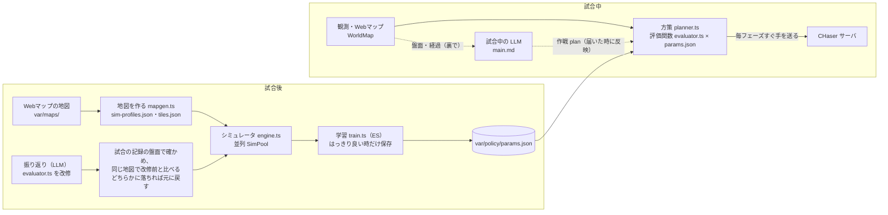

# 方策・シミュレータ・学習

試合中の手は**経路探索の方策**（`src/solver/planner.ts`、1手数ミリ秒）が毎フェーズ必ず出す。LLM は待たない。試合中の LLM は裏で盤面を読み、作戦（`plan` の目標）を出す係で、届いた時から方策が使う。試合後は**シミュレータ**で方策のパラメータを学習し、LLM が評価関数（`src/solver/evaluator.ts`）を直したら試合の記録とシミュレータで確かめて採否を決める。

## 試合中

| 役 | ファイル | 内容 |
| :--- | :--- | :--- |
| 方策 | `src/solver/planner.ts`（ハーネス） | 知っているマスで Dijkstra。目標の候補（得点のあるマス＋固まりの加点・未知との境目・ワープ・LLM の作戦の目標）から上位 K 個を選び、残りの歩数の中で回る順をビームサーチ。最初の一歩（歩く・斜め）を返す。ワープの中心が見えたら `gr`。行ける目標が無い時は、知っている通れるマスへ動く（場外 -500 を避ける） |
| 評価関数 | `src/solver/evaluator.ts`（**エージェントが直してよい**） | マスの通りにくさ（`stepCost`）・目標の価値（`targetValue`）・得点（`tileGain`）と、パラメータの範囲（`PARAM_SPACE`）。学習で決まった値は `var/policy/params.json` |
| 試合中の LLM | `src/agent/main-agent.ts`・`agent/prompts/main.md` | 方策を待たせず、毎フェーズ「考え中でなければ」今の盤面（全体マップ・経過・メモ・方策の判断）で裏の問い合わせを始める。返ってきた `plan` を作戦にする（考えている間にワープなどで座標系が変わっていれば、その目標は捨てる）。1回の上限は `AGENT_TURN_BUDGET_SEC` |

時間でターンが進むルーム（room 455 のように1ターン約5秒）では、LLM の返答（24〜105秒）を待つと手が間に合わなかった。方策が手を出し、LLM は作戦だけにしたのはこのため（2026-11-22 に、LLM の返答を待って打つモード・サブエージェント・古いソルバー `active-solver.ts` は外した）。

## シミュレータ（`src/sim/`）

| ファイル | 内容 |
| :--- | :--- |
| `engine.ts` | ルール: 動き・観測（`CMD1_SPECS`/`CMD2_SPECS`）、得点は `getTileInfo`（`knowledge/tiles.json`）。ターン完了 +300、場外 -500（動かない）、岩盤・プレイヤーは通れない、踏んだマスは穴、ワープ（十の位で距離 2:10・3:5・4:6・5:15、一の位で向き）、ブラックスター 60→63、端の観測は要素が少ない。相手にアイテム・土を置いて当てると、当てた側 +・当てられた側 − に `putHit`（`sim-profiles.json`。公式の値は未確認の仮の値 5000） |
| `mapgen.ts` | **毎回ランダムに地図を作る**（seed が同じなら同じ地図）。`knowledge/sim-profiles.json` のタイルの重み・帯・固まり・ワープ数に、`tiles.json` にあって重みに無いタイル（新しく分かったアイテム）を `otherTiles` の重みで混ぜる。大きさ・ターン数・Webマップの有無はルームの実測（`var/room-profiles.json`）に合わせる。本物の地図（`var/maps/room<N>/`、試合中の最初の Webマップを runner が保存）を `realMapShare` の割合で、少し変えて使う |
| `episode.ts` | 1試合。自分は本番と同じ `WorldMap`（観測の反映・Webマップでの位置合わせ）と方策で打つ。相手は下の「相手と自己対戦」 |
| `bots.ts`・`opponents.ts` | 相手（拾う・狙う・自分）と、自己対戦の相手の控え（リーグ `var/policy/league.json`） |
| `pool.ts`・`worker.ts` | Bun Worker で並列（`SIM_WORKERS`、既定は CPU 数−2、最大16） |
| `train.ts` | 学習（ES、対称サンプリング）。目的は 1ターンあたりの得点の平均。学習に使わない地図で確かめ、差が標準誤差の1.5倍より大きく罠も増えない時だけ保存 |
| `post-match.ts` | 試合後: 評価関数の改修の比較（弱くなっていない＝`notWorse` で合格）・ルームでの成績（振り返りに渡す） |
| `lab.ts` | 学習の仕事の受け持ち（WebUI の「地図を作る → 並べた地図で学習 → 統計」、試合後の学習 `TRAIN_AFTER_MATCH_MIN`、試合をしていない間の学習 `TRAIN_IDLE`）。同時に1つ |
| `fake-server.ts` | シミュレータを CHaser サーバの形で出す偽サーバ。ハーネス全体（ログイン〜Webマップ〜記録）を手元で通す（本番サーバに触れない）。`src/sim/fake-server.test.ts` が `bun src/play.ts` で1試合通す |

### 新しいマップに出会ったら

- 方策は地図を覚えていない（その場で見えているマスから経路を探す）ので、初めてのマップでも同じように動く。
- その試合の Webマップは `var/maps/` に残り、次の学習から本物の地図として混ざる。ルームの大きさ・ターン数も実測が地図作りに入る。
- 見たことのないタイルは `tiles.json` に登録されると（振り返り・得点の実測）、次の地図作りから混ざる。

## 相手と自己対戦（`src/sim/opponents.ts`・`bots.ts`）

本番のルームには他のプレイヤーがいて、点を取り合い、置いて当ててくる（room 455 では6ターンのうちにプットダメージ -44990）。シミュレータでも相手がいる前提で学習する。

| 相手 | 動き |
| :--- | :--- |
| 拾う（greedy） | 地図を全部知っていて、一番近い点のあるマスへ歩く |
| 狙う（hunter） | 12 歩以内に他のプレイヤーがいれば追いかけ、隣に来たらアイテムを置いて当てる（`p*3s*`）。いなければ拾う |
| 自分（self） | 自分と同じ方策（経路探索＋評価関数）。観測と Webマップだけで動く。パラメータは半分が今のもの、半分がリーグ（前に採用したもの）から |

- 人数は `sim-profiles.json` の `players`（自分を含む。既定 2〜4。本物の地図は保存した時の人数）。種類の重みは `train-config.json` の `oppGreedy`・`oppHunter`・`oppSelf`（既定 1・1・2）。
- 相手は地図の seed から決める。比べる2つの方策は同じ地図で同じ相手と戦う。学習の間は相手を変えない（始めた時のパラメータとリーグ）。
- **自己対戦**: 学習で新しいパラメータが採用されると、置き換わる前のパラメータをリーグに足す（新しい順に `leagueSize` 人、既定 6）。次からの学習では「今の自分」と「前の自分」が相手になり、前の自分に勝てる方へ進む。
- 方策は CMD2 で、隣（上下左右）に今のターンに見えた敵がいれば、その向きにアイテムを置いて当てる（`p*3s*`、-30、置いた後に横へ1マス動く。動いた先が分かっていて安全な時だけ）。当てるかは評価関数の `attackGain`（当てる価値の見込み）が予定の一歩の得点 + 30 より大きいか。近づかない範囲は `enemyRadius`。どちらも学習で決まる。**本番の試合でも当てに行く**（`attackGain` を 0 にすれば当てない）。
- 結果には相手の種類・当てた／当てられた・勝ち（自分の得点が全員より高い）が出る（「学習」画面・学習の LLM の report.md・`bun src/cli.ts sim`）。学習の目的は今までどおり自分の 1ターンあたりの得点（当てられた分も入る）。

## 特性ごとのモデル（`src/solver/models.ts`・`src/sim/model-traits.ts`）

方策（経路探索＋評価関数）は1つで、学習するパラメータを**目的を変えて別々に**学習したものを「モデル」と呼ぶ。定義は `knowledge/styles.json`（名前・特性・説明・目的・動かさないパラメータ）。

| モデル | 特性 | 学習の目的（1ターンあたり） |
| :--- | :--- | :--- |
| バランス（`standard`） | 標準 | 自分の得点（今までの方策。パラメータは `var/policy/params.json`） |
| ハンター（`hunter`） | 攻撃型 | 自分の得点 ＋ 当てた得点（当てた分を2倍に数える） |
| コレクター（`collector`） | 回収型 | 自分の得点 ＋ アイテムの得点 × 0.5。`attackGain` を 0 に固定（当てない） |
| ガーディアン（`guardian`） | 慎重型 | 自分の得点 ＋ 当てられた得点（2倍に数える）－ 罠1回 500 |

- 目的に足せるのは `item`（アイテムの得点）・`put`（当てた得点）・`putDamage`（当てられた得点、負の値）・`hazard`（罠を踏んだ回数）の重み。`fixed` に書いたパラメータは学習で動かさない。
- 標準以外のパラメータは `var/policy/models/<id>.json`。まだ学習していないモデルは標準のパラメータから始まる（`fixed` は当てはめる）。採用の決め方（確かめ用の地図ではっきり良くなったら）と自己対戦のリーグは同じ。学習するモデルの「自分」の相手には、前の自分（リーグ）に加えて**ほかのモデル**も入る（ハンターとも戦って学ぶ）。
- **試合で使うモデル**は設定の `POLICY_MODEL`（既定 `standard`。「学習」画面の「モデルとパラメータ」からも選べる）。試合後の学習もこのモデルを育てる。試合の記録の `policy-params.json` に、使ったモデルとパラメータが残る。試合をしていない間の学習は、試合で使うモデルを2回に1回、残りはほかのモデルを順に育てる。
- **特性を測る**: 全部のモデルを同じ 24 枚の地図・同じ相手（拾う・狙う・バランスの「自分」）で打たせて、点/ターン・回収/ターン・勝ち・当てた回数（100 ターンあたり。攻撃性）・当てられた回数・罠を比べ、`var/policy/model-profiles.json` に残す。学習で採用されると自動で測り直す。札（攻撃的・当てない・打たれにくい・回収が多い・勝負強い・得点が一番 など）は、ほかのモデルと比べて読む時に付ける。
- 当てた回数は `putHit`（仮の 5000）で割って数えるので、本物の値が分かるまでは目安。

## WebUI の「学習」画面

ヘッダの「学習」で開く（[webui.md](webui.md)）。「地図を作る」で地図（既定 12 枚）を作って並べ、今の方策で全部打たせて同時に再生する。「この地図で学習」でその地図の組で学習し（`trainPolicy` の `trainSet`。毎世代、組から選ぶ）、終わると学習前・学習後の方策で同じ地図を打たせ直して、地図ごとの前→後と平均を出す。保存するかは、組に入っていない確かめ用の地図で決める（組だけに合わせすぎないため）。「試合をしていない間も学習を続ける」（`TRAIN_IDLE`）は毎回新しい地図で学習し、良くなった時だけ保存する（試合が始まると止まる）。「モデル」で打たせる・学習するモデルを選ぶ。「モデルとパラメータ」の表示に、モデルごとの特性と、学習するパラメータ全部（評価関数の `PARAM_SPACE`: 名前・意味・範囲・初めの値・モデルごとの値・最後に採用した学習での変化）を並べる。仕事は `src/sim/lab.ts` がまとめて受け持つ（試合後の学習も同じ）。

## 学習の LLM（学習環境を直す。`src/sim/lab-coach.ts`）

試合中の LLM とは別のセッション。学習（並べた地図・試合後・空き時間）が終わるたびに続けて動く（`LAB_COACH`、既定オン。試すだけ・止めた・試合中は動かない。試合後の学習は次の試合の前なので動く）。

1. `var/lab-coach/<日時>/` に統計 `report.md`（学習の前→後と確かめ用の地図の結果、地図ごとの点/ターン・罠・足踏み・方策の誤り、作った地図と本物の地図のタイルの割合の違い、最近の学習）と再生の記録 `traces.json` を書き出す。並べた地図で学習した時はその地図の前→後、それ以外は今の方策で 12 枚打たせたもの。
2. ツールありの Claude Code（`agent/prompts/lab-coach.md`、モデルは `LAB_COACH_MODEL`・空なら LLM と同じ、上限 `LAB_COACH_TIMEOUT_MIN` 分）が読んで直す。直してよいのは次の3つ:
   - **評価関数** `src/solver/evaluator.ts` → 改修前と同じ地図で比べ（`gateEvaluatorChange`、試合後の振り返りと同じ）、弱くなっていれば戻す。
   - **地図の作り方** `knowledge/sim-profiles.json` → 地図が作れなければ戻す。本物の地図があるルームで、作った地図のタイルの割合が本物から遠ざかったら（L1 距離が 0.02 より増えたら）戻す。方策の得点では比べない（易しい地図にすれば得点は上がってしまうので）。
   - **学習のやり方** `knowledge/train-config.json`（1世代の候補の数 `popSize`・地図の数 `batch`・確かめ用の地図の数 `validation`・探す幅 `sigmaStart`/`sigmaEnd`。`trainPolicy` が毎回読む）→ 範囲の外なら戻す。
3. それ以外（ハーネス）の変更は戻す（edit-guard）。試合が始まる・「止める」を押すと LLM を止め、確かめていない改修を全部戻す。結果は `var/lab-coach/log.jsonl` に残し、「学習」画面に出す。

## CLI（`bun src/cli.ts …`）

| コマンド | 内容 |
| :--- | :--- |
| `sim --room N --n 8 --seed 1 [--max-turns 200] [--model id]` | 方策をシミュレータで打たせて得点を出す（`--model` 既定は試合で使うモデル） |
| `bench --room N --n 24 [--evaluator <file>] [--model id]` | 2つを同じ地図で比べる（既定: 既定のパラメータと学習したパラメータ。`--evaluator` で今の evaluator.ts と別ファイル） |
| `triggers --n 12 [--room N] [--model id]` | 試合中の LLM を呼ぶきっかけ（[architecture.md](architecture.md)）が 100 ターンあたり何回鳴るかを数える |
| `train --room N --minutes 5 [--dry-run] [--model id]` | そのモデルを、そのモデルの目的で学習する（`--dry-run` で保存しない） |
| `bun scripts/sim-server.ts --port 3990 --seed 1 [--room N --turns 100 --web true]` | 偽サーバを起動（`HOST_URL=http://127.0.0.1:3990/CHaserOnline003/user/ CHASER_USER=sim CHASER_PASS=sim CHASER_TEST_VAR_DIR=<一時フォルダ> AGENT_USE_MAIN=false bun run play --room 1`） |

## 分かっていないこと（シミュレータと本物の差）

- ワープの飛び方は資料のルール。room 719 の実測は揺れがあり、本物の地図が貯まったら合わせる。
- put の当たりの得点は仮の値（`putHit` 5000。room 455 で PD -44990 を記録）。公式結果のプット得点・プットダメージが貯まったら合わせる。本物の相手の動き（追ってくるか・どのくらい当ててくるか）も分かっていない。狙う相手は隣にいる限り毎ターン当ててくるので、当てられた得点は地図によって大きく振れる。
- 時間で進むルームの途中のフェーズの扱いは再現していない。
- フィールドの端の観測（要素が9より少ない）は、`WorldMap.expandEdgeValues` が 3×3 の正しい位置に並べ直す（Webマップの大きさ → 中心の自機の番号の位置 → 分かっているマスとの食い違い、の順で決める。決められなければ使わない）。抜けたマスはフィールドの外として通れない壁にし（`offField`）、Webマップの外周1マスも壁として扱う。以前は端の観測を捨てていたので、端で踏んだマスが「まだアイテムがある」ままになり、取りに行っては戻る足踏みをしていた（直した後、シミュレータの 40 地図で 点/ターン が 2 割前後上がった）。
