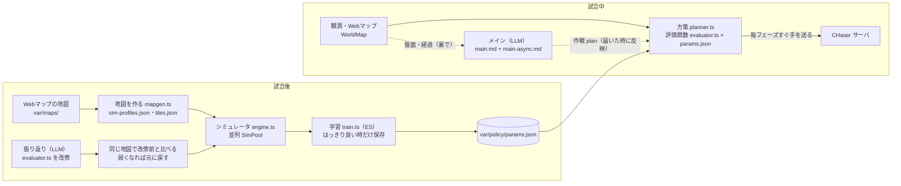

# 方策・シミュレータ・学習

試合中の手は**経路探索の方策**（`src/solver/planner.ts`、1手数ミリ秒）が毎フェーズ必ず出す。LLM は待たない。LLM（メイン）は裏で盤面を読み、作戦（`plan` の目標）を出す係で、着いた時に方策が使う。試合後は**シミュレータ**で方策のパラメータを学習し、エージェントが評価関数（`src/solver/evaluator.ts`）を直したらシミュレータで比べて採否を決める。

## 試合中

| 役 | ファイル | 内容 |
| :--- | :--- | :--- |
| 方策 | `src/solver/planner.ts`（ハーネス） | 知っているマスで Dijkstra。目標の候補（得点のあるマス＋固まりの加点・未知との境目・ワープ・メインの作戦の目標）から上位 K 個を選び、残りの歩数の中で回る順をビームサーチ。最初の一歩（歩く・斜め）を返す。ワープの中心が見えたら `gr`。行ける目標が無い時は、知っている通れるマスへ動く（場外 -500 を避ける） |
| 評価関数 | `src/solver/evaluator.ts`（**エージェントが直してよい**） | マスの通りにくさ（`stepCost`）・目標の価値（`targetValue`）・得点（`tileGain`）と、パラメータの範囲（`PARAM_SPACE`）。学習で決まった値は `var/policy/params.json` |
| メイン（LLM） | `src/agent/main-agent.ts`・`agent/prompts/main-async.md` | `AGENT_ASYNC=true`（既定）: 方策を待たせず、毎フェーズ「考え中でなければ」今の盤面（全体マップ・経過・メモ・方策の判断）で裏の問い合わせを始める。返ってきた `plan` を作戦にする（考えている間にワープなどで座標系が変わっていれば、その目標は捨てる）。`command` は使わない。`delegate` はそのままサブへ |
| 切替 | `PLAY_POLICY` | `planner`（既定）/ `solver`（前の `active-solver.ts`） |

時間でターンが進むルーム（room 455 のように1ターン約5秒）では、LLM の返答（24〜105秒）を待つと手が間に合わなかった。方策が手を出し、LLM は作戦だけにしたのはこのため。

## シミュレータ（`src/sim/`）

| ファイル | 内容 |
| :--- | :--- |
| `engine.ts` | ルール: 動き・観測（`CMD1_SPECS`/`CMD2_SPECS`）、得点は `getTileInfo`（`knowledge/tiles.json`）。ターン完了 +300、場外 -500（動かない）、岩盤・プレイヤーは通れない、踏んだマスは穴、ワープ（十の位で距離 2:10・3:5・4:6・5:15、一の位で向き）、ブラックスター 60→63、端の観測は要素が少ない。put の当たりの得点は不明なので 0 |
| `mapgen.ts` | **毎回ランダムに地図を作る**（seed が同じなら同じ地図）。`knowledge/sim-profiles.json` のタイルの重み・帯・固まり・ワープ数に、`tiles.json` にあって重みに無いタイル（新しく分かったアイテム）を `otherTiles` の重みで混ぜる。大きさ・ターン数・Webマップの有無はルームの実測（`var/room-profiles.json`）に合わせる。本物の地図（`var/maps/room<N>/`、試合中の最初の Webマップを runner が保存）を `realMapShare` の割合で、少し変えて使う |
| `episode.ts` | 1試合。自分は本番と同じ `WorldMap`（観測の反映・Webマップでの位置合わせ）と方策で打つ。相手は地図を全部知っていて近い得点へ歩く |
| `pool.ts`・`worker.ts` | Bun Worker で並列（`SIM_WORKERS`、既定は CPU 数−2、最大16） |
| `train.ts` | 学習（ES、対称サンプリング）。目的は 1ターンあたりの得点の平均。学習に使わない地図で確かめ、差が標準誤差の1.5倍より大きく罠も増えない時だけ保存 |
| `post-match.ts` | 試合後: 評価関数の改修の比較（弱くなっていない＝`notWorse` で合格）・ルームでの成績（振り返りに渡す） |
| `lab.ts` | 学習の仕事の受け持ち（WebUI の「地図を作る → 並べた地図で学習 → 統計」、試合後の学習 `TRAIN_AFTER_MATCH_MIN`、試合をしていない間の学習 `TRAIN_IDLE`）。同時に1つ |
| `fake-server.ts` | シミュレータを CHaser サーバの形で出す偽サーバ。ハーネス全体（ログイン〜Webマップ〜記録）を手元で通す（本番サーバに触れない）。`src/sim/fake-server.test.ts` が `bun src/play.ts` で1試合通す |

### 新しいマップに出会ったら

- 方策は地図を覚えていない（その場で見えているマスから経路を探す）ので、初めてのマップでも同じように動く。
- その試合の Webマップは `var/maps/` に残り、次の学習から本物の地図として混ざる。ルームの大きさ・ターン数も実測が地図作りに入る。
- 見たことのないタイルは `tiles.json` に登録されると（サブ・振り返り・得点の実測）、次の地図作りから混ざる。

## WebUI の「学習」画面

ヘッダの「学習」で開く（[webui.md](webui.md)）。「地図を作る」で地図（既定 12 枚）を作って並べ、今の方策で全部打たせて同時に再生する。「この地図で学習」でその地図の組で学習し（`trainPolicy` の `trainSet`。毎世代、組から選ぶ）、終わると学習前・学習後の方策で同じ地図を打たせ直して、地図ごとの前→後と平均を出す。保存するかは、組に入っていない確かめ用の地図で決める（組だけに合わせすぎないため）。「試合をしていない間も学習を続ける」（`TRAIN_IDLE`）は毎回新しい地図で学習し、良くなった時だけ保存する（試合が始まると止まる）。仕事は `src/sim/lab.ts` がまとめて受け持つ（試合後の学習も同じ）。

## 学習の LLM（学習環境を直す。`src/sim/lab-coach.ts`）

試合中の LLM とは別のセッション。学習（並べた地図・試合後・空き時間）が終わるたびに続けて動く（`LAB_COACH`、既定オン。試すだけ・止めた・試合中は動かない。試合後の学習は次の試合の前なので動く）。

1. `var/lab-coach/<日時>/` に統計 `report.md`（学習の前→後と確かめ用の地図の結果、地図ごとの点/ターン・罠・足踏み・方策の誤り、作った地図と本物の地図のタイルの割合の違い、最近の学習）と再生の記録 `traces.json` を書き出す。並べた地図で学習した時はその地図の前→後、それ以外は今の方策で 12 枚打たせたもの。
2. ツールありの Claude Code（`agent/prompts/lab-coach.md`、モデルは `LAB_COACH_MODEL`・空なら LLM と同じ、上限 `LAB_COACH_TIMEOUT_MIN` 分）が読んで直す。直してよいのは次の3つ:
   - **評価関数** `src/solver/evaluator.ts` → 改修前と同じ地図で比べ（`gateEvaluatorChange`、試合後の振り返りと同じ）、弱くなっていれば戻す。
   - **地図の作り方** `knowledge/sim-profiles.json` → 地図が作れなければ戻す。本物の地図があるルームで、作った地図のタイルの割合が本物から遠ざかったら（L1 距離が 0.02 より増えたら）戻す。方策の得点では比べない（易しい地図にすれば得点は上がってしまうので）。
   - **学習のやり方** `knowledge/train-config.json`（1世代の候補の数 `popSize`・地図の数 `batch`・確かめ用の地図の数 `validation`・探す幅 `sigmaStart`/`sigmaEnd`。`trainPolicy` が毎回読む）→ 範囲の外なら戻す。
3. それ以外（ハーネス・ソルバー）の変更は戻す（edit-guard）。試合が始まる・「止める」を押すと LLM を止め、確かめていない改修を全部戻す。結果は `var/lab-coach/log.jsonl` に残し、「学習」画面に出す。

## CLI（`bun src/cli.ts …`）

| コマンド | 内容 |
| :--- | :--- |
| `sim --room N --n 8 --seed 1 [--policy solver] [--max-turns 200]` | 方策をシミュレータで打たせて得点を出す |
| `bench --room N --n 24 [--evaluator <file>]` | 2つを同じ地図で比べる（既定: solver と planner。`--evaluator` で今の evaluator.ts と別ファイル） |
| `train --room N --minutes 5 [--dry-run]` | 学習する（`--dry-run` で保存しない） |
| `bun scripts/sim-server.ts --port 3990 --seed 1 [--room N --turns 100 --web true]` | 偽サーバを起動（`HOST_URL=http://127.0.0.1:3990/CHaserOnline003/user/ CHASER_USER=sim CHASER_PASS=sim CHASER_TEST_VAR_DIR=<一時フォルダ> AGENT_USE_MAIN=false bun run play --room 1`） |

## 分かっていないこと（シミュレータと本物の差）

- ワープの飛び方は資料のルール。room 719 の実測は揺れがあり、本物の地図が貯まったら合わせる。
- put の当たりの得点（room 455 で PD -44990 を記録）・相手の動き・時間で進むルームの途中のフェーズの扱いは再現していない。
- フィールドの端の観測（要素が9より少ない）は、`WorldMap.expandEdgeValues` が 3×3 の正しい位置に並べ直す（Webマップの大きさ → 中心の自機の番号の位置 → 分かっているマスとの食い違い、の順で決める。決められなければ使わない）。抜けたマスはフィールドの外として通れない壁にし（`offField`）、Webマップの外周1マスも壁として扱う。以前は端の観測を捨てていたので、端で踏んだマスが「まだアイテムがある」ままになり、取りに行っては戻る足踏みをしていた（直した後、シミュレータの 40 地図で 点/ターン が 2 割前後上がった）。
